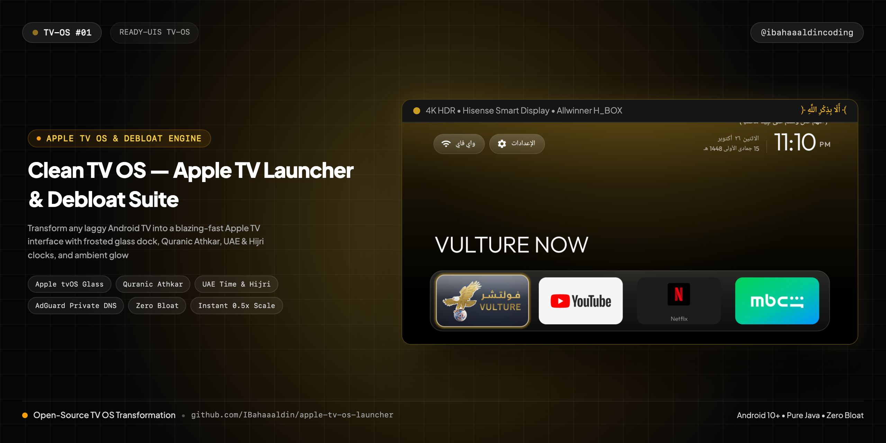
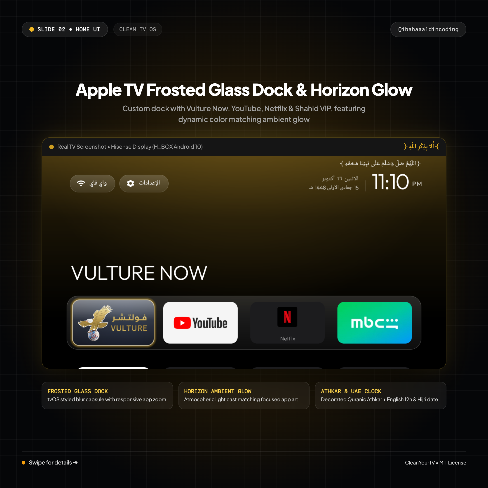
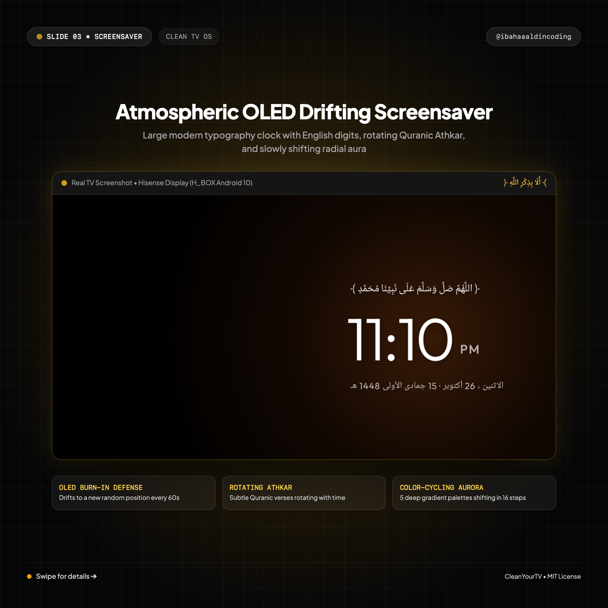
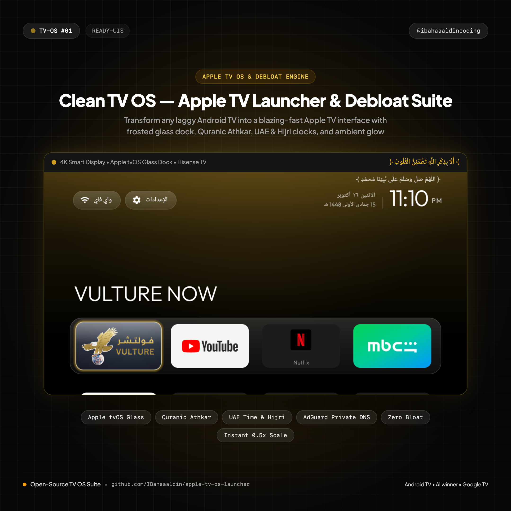
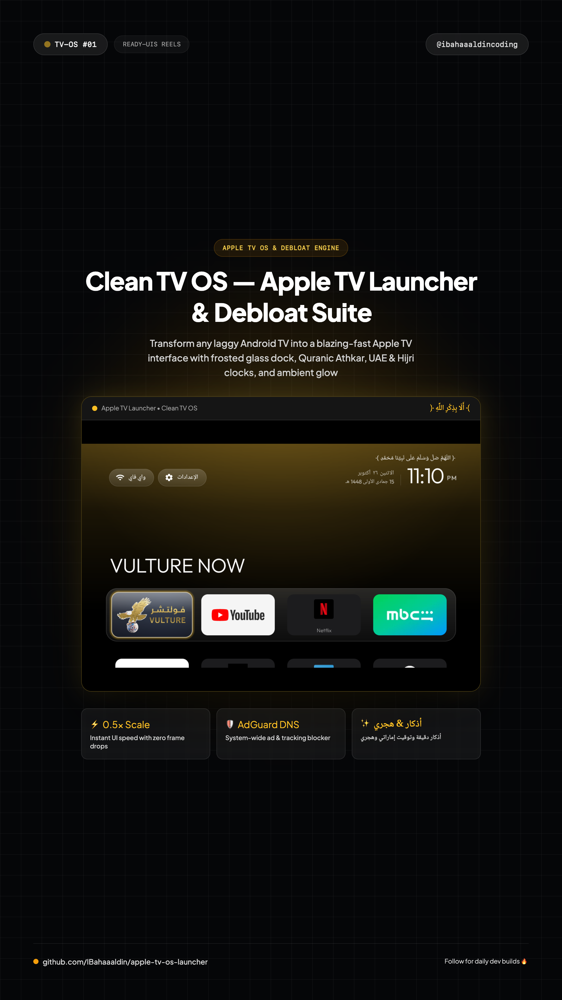

# 📺 Clean TV OS — Apple TV Launcher & Debloat Suite

> Transform any laggy, ad-infested Android TV into a blazing-fast Apple TV interface with frosted glass dock, Quranic Athkar, UAE & Hijri clocks, and ambient glow.



[](https://IBahaaaldin.github.io/apple-tv-os-launcher/)
[](https://IBahaaaldin.github.io/apple-tv-os-launcher/)
[](clean-tv-launcher-release.apk)
[](restore.sh)

---

## 🌐 Visual Previews

| Desktop Showcase (2400x1800) | Screensaver Showcase (2160x2160) | Post Cover (1080x1080) | Reel Cover (1080x1920) |
| :---: | :---: | :---: | :---: |
|  |  |  |  |

*(Includes full interactive HTML5 simulation: `index.html`, and real TV sideload package: `clean-tv-launcher-release.apk`)*

---

## ✨ Features & Micro-Interactions

- **Apple tvOS Frosted Glass Dock**: Clean blurred capsule with responsive app zoom, spring animation feedback, and smooth TV remote D-pad ergonomics.
- **Dynamic Horizon Ambient Glow**: Atmospheric lighting cast across the wall/screen behind the focused app (Golden for Vulture Now, Emerald for Shahid VIP, Red for Netflix & YouTube).
- **Decorated Quranic Athkar**: Rotating Islamic Athkar (`﴿ أَلَا بِذِكْرِ اللَّهِ تَطْمَئِنُّ الْقُلُوبُ ﴾`) positioned gracefully above the clock digits.
- **UAE Time & Hijri Calendar**: Western English digits (`11:10 PM`) paired with Arabic Gregorian date and Islamic Hijri date (`15 جمادى الأولى 1448 هـ`).
- **26 Bloatware Packages Safely Disabled**: Ads, tracking telemetry, factory tests, and sluggish stock launchers disabled with zero root required (`pm disable-user --user 0`).
- **+1,000 MB Storage Recovered**: Reclaimed internal memory on 98% full TV flash storage, eliminating frame drops and boot lags.
- **System-Wide AdGuard Private DNS**: Configured at system settings level to block tracking domains, banners, and popup ads across all TV apps.
- **0.5x Window Animation Scales**: Cut UI transition durations in half for instant, snappy remote responsiveness.
- **OLED Drifting Ambient Screensaver**: Burn-in safe ambient mode drifting once a minute with bold typography (115sp), rotating Athkar, full Hijri date, and 5 shifting gradient color auras.
- **Interactive Web Simulation**: Zero-build HTML5 + Tailwind CSS web app replicating the TV experience with arrow keys, launch feedback, and screensaver toggle.

---

## 📁 Repository Structure

```text
├── index.html                    # Interactive web demo with full TV remote key simulation
├── clean-tv-launcher-release.apk # Production release APK (532 KB, minSdk 26, zero network permissions)
├── debloat-list.txt              # 26 tested bloatware packages safely removed
├── restore.sh                    # 1-click restore script to re-enable stock launcher & packages
├── cover.png                     # Widescreen cover banner (2560x1280)
├── cover-instagram.png           # Square post cover for Instagram (@ibahaaaldincoding) (2160x2160)
├── cover-reel.png                # 9:16 vertical cover for Instagram Reels (2160x3840)
├── screenshot-desktop.png        # Desktop showcase preview (2400x1800)
├── screenshot-screensaver.png    # Screensaver showcase preview (2160x2160)
├── shot-home.png                 # Direct TV screenshot (Hisense 4K / Allwinner Android 10)
├── shot-screensaver.png          # Direct TV screenshot of live screensaver
├── shot-before-debloat.png       # Direct TV screenshot before debloating
├── README.md                     # Standardized documentation & setup notes
└── CAPTION.md                    # Ready-to-copy Instagram caption for @ibahaaaldincoding
```

---

## 🚀 Quick Start

### 1. Try the Web Simulation
Simply open `index.html` in your browser:
```bash
open index.html
```
- Use **Left / Right Arrow Keys** to browse dock apps.
- Press **Up Arrow** to focus top Wi-Fi & Settings buttons.
- Press **Enter** to simulate app launch.
- Press **S** or **Spacebar** to enter the ambient drifting Screensaver.

### 2. Install on Your TV Box (via ADB)
Connect to your Android TV or TV Box over Wi-Fi:
```bash
# Connect ADB
adb connect <tv-ip>:5555

# Sideload the Clean Launcher
adb install -r clean-tv-launcher-release.apk

# Make it Default Home
adb shell cmd package set-home-activity com.gathin.tvhome/.MainActivity

# Disable Bloatware
adb shell "pm disable-user --user 0 com.google.android.tvrecommendations"
# (Run debloat-list.txt for full cleanup)

# Enable 0.5x Fast Animation Speed
adb shell settings put global window_animation_scale 0.5
adb shell settings put global transition_animation_scale 0.5
adb shell settings put global animator_duration_scale 0.5

# Enable AdGuard Private DNS
adb shell settings put global private_dns_mode hostname
adb shell settings put global private_dns_specifier dns.adguard-dns.com
```

### 3. Restore Anytime
To revert back to the stock TV interface at any time:
```bash
sh restore.sh
```

---

## 👤 Author & Connect

**Bahaa Mohammed**  
Creative Developer & Software Engineer
- 📸 **Instagram**: [@ibahaaaldincoding](https://www.instagram.com/ibahaaaldincoding)
- 🐙 **GitHub**: [@IBahaaaldin](https://github.com/IBahaaaldin)
- 💼 **LinkedIn**: [Bahaa Mohammed](https://www.linkedin.com/in/bahaa-mohammed-371259369)
- 📧 **Email**: bahaam.coding@gmail.com

---

## 📄 License

MIT © [Bahaa Mohammed](https://github.com/IBahaaaldin)
